<h1 align="center">
  
</h1>

An online watch store with a customer storefront, an admin console and a mobile app: browse and filter watches, pick colours and straps, check out with Stripe or cash on delivery, and manage products, orders, refunds, inventory, customers, coupons and support from the admin side.

> **Status:** the overhaul is complete: a Next.js and TypeScript web app, an Express, Prisma and PostgreSQL API, an Expo React Native app and Stripe Checkout in test mode. The original Flutter and Firebase application, built as a team project at Aptech, is kept in [`legacy/`](legacy).

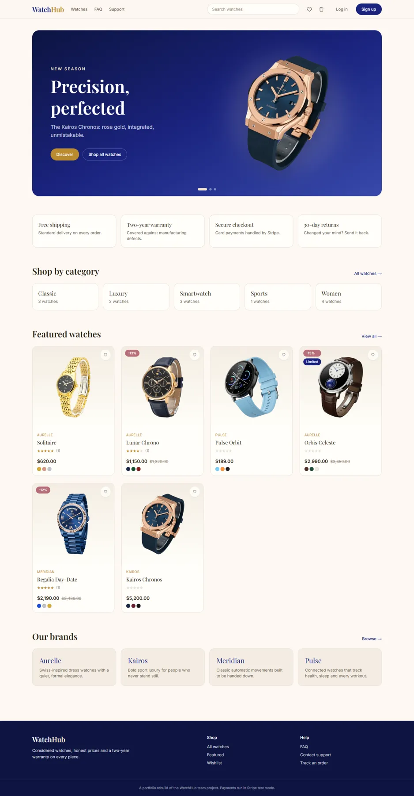

## Screens

### Storefront

| | |
|---|---|
| 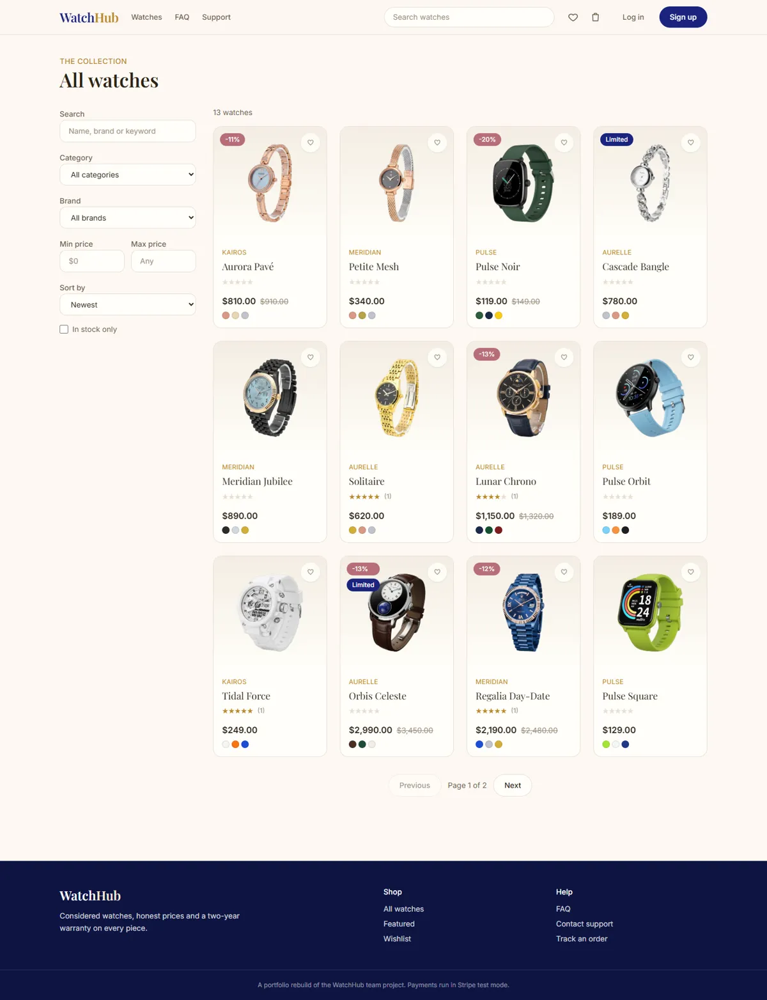 | 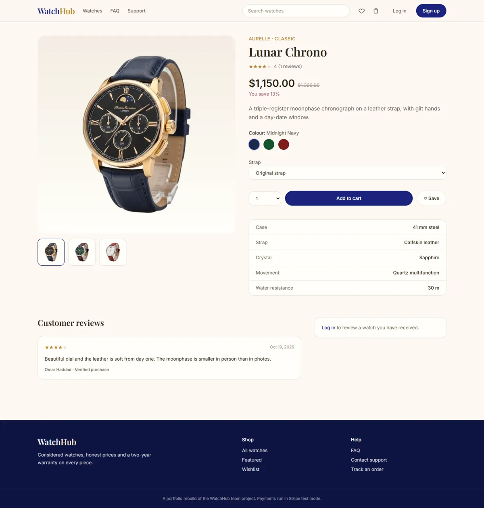 |
| **All watches**: filters, sort and quick add | **Product**: colour swatches that swap the photo, straps, stock states |
| 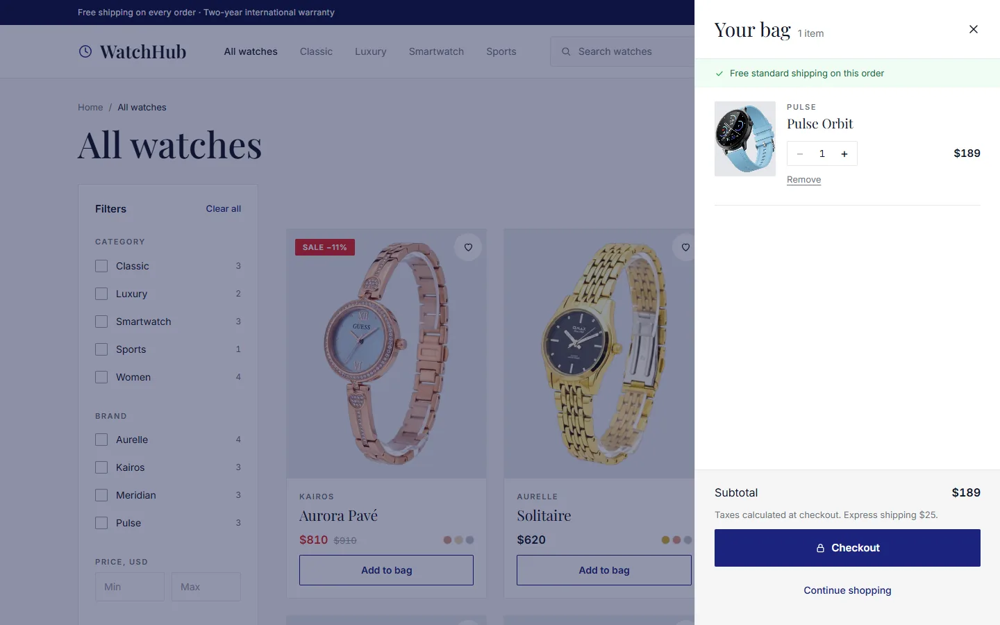 | 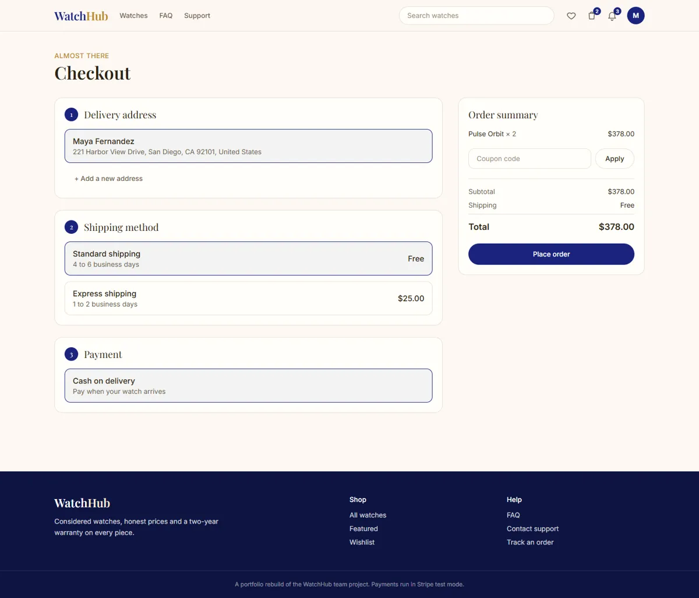 |
| **Bag drawer** with the free-shipping note | **Checkout**: address, delivery, coupon and Stripe or cash on delivery |

### Admin console, light and dark

| | |
|---|---|
| 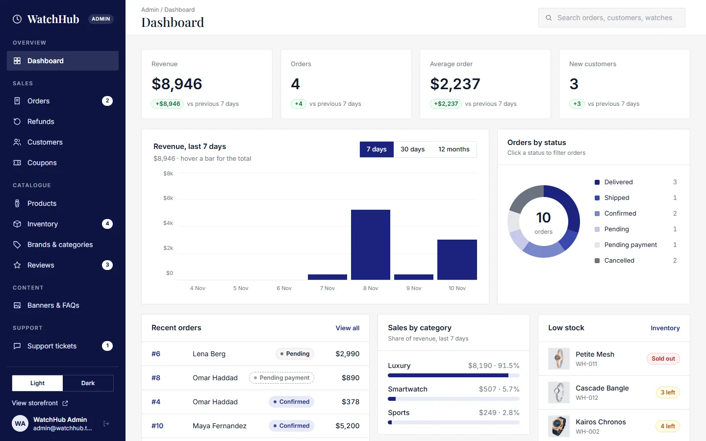 | 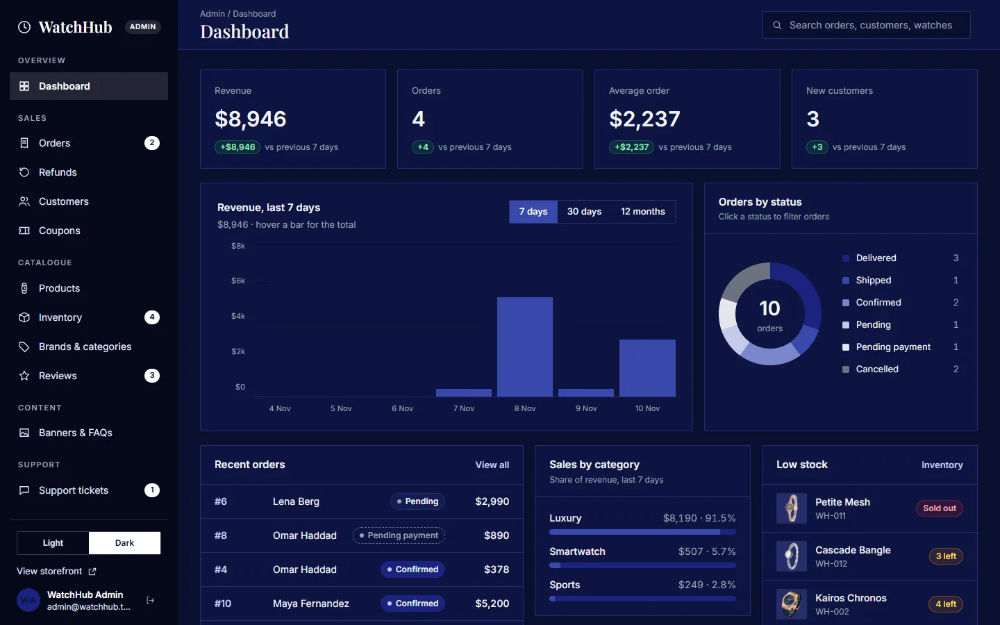 |
| **Dashboard**: KPIs with deltas, revenue chart, orders by status, low stock | **Dark theme**, toggled from the sidebar and remembered |
| 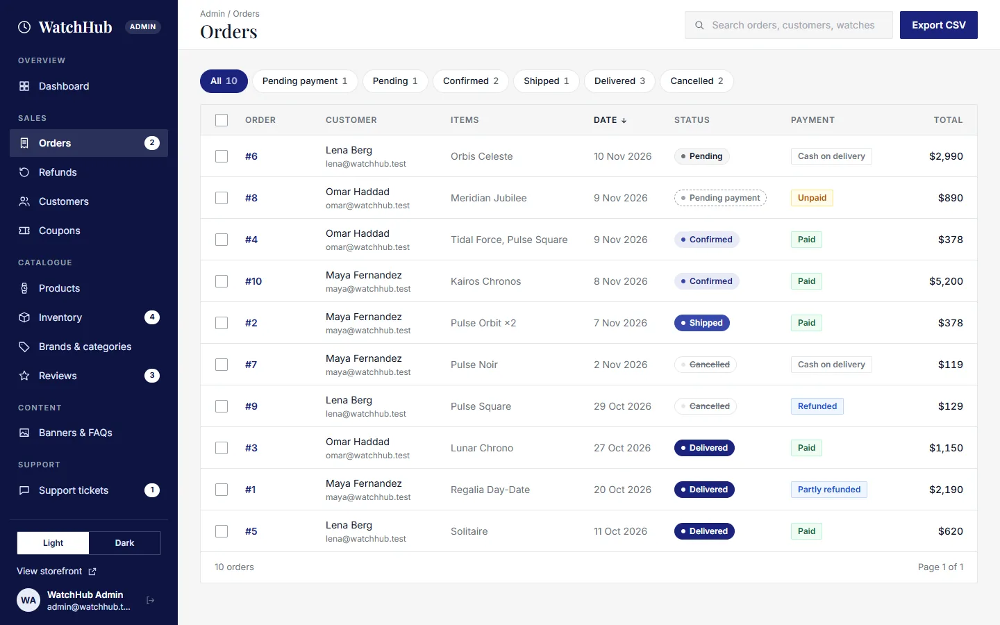 | 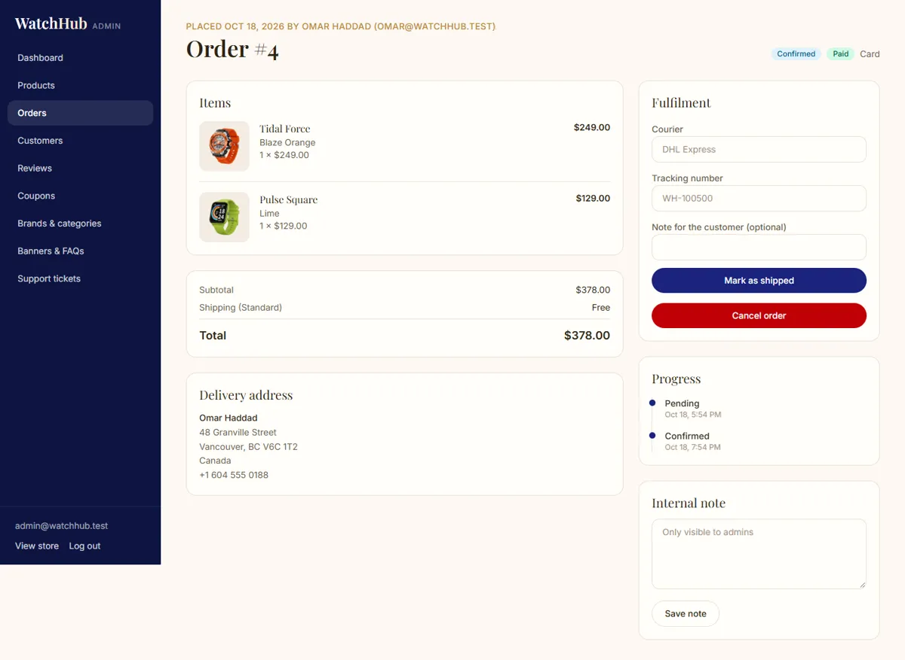 |
| **Orders**: status tabs, bulk actions, CSV export | **Order**: confirm, ship with tracking, deliver, refund, notes |
| 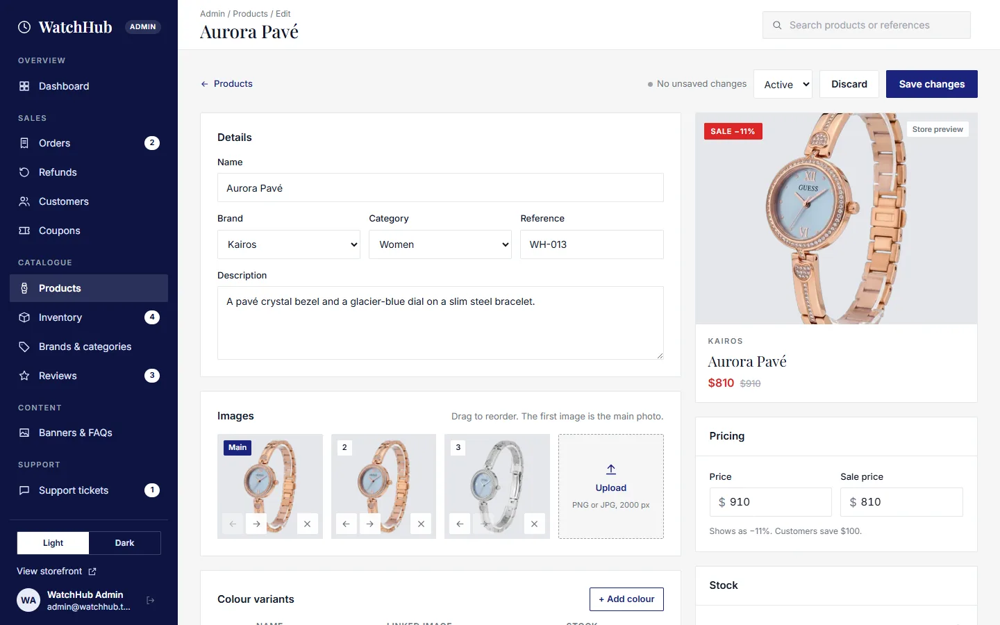 | 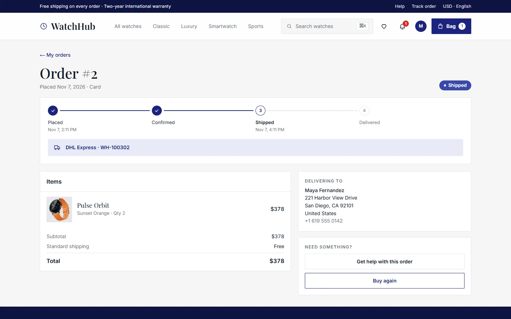 |
| **Product editor**: images, colours with stock, specs | **Customer order page** with timeline and tracking |

### Mobile app

<p>
  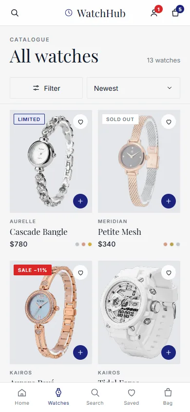
  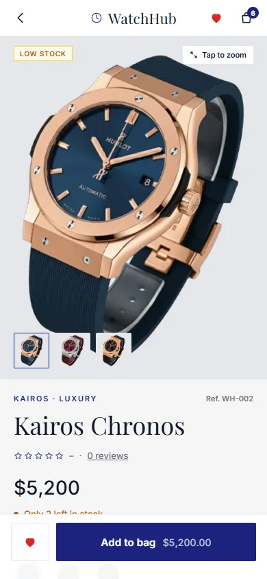
  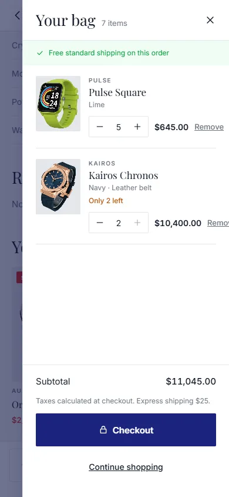
  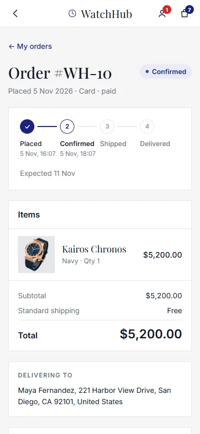
</p>

## The overhaul

| Part | Stack |
|---|---|
| [`web/`](web) | Next.js 15 (App Router), React 19, TypeScript, Tailwind CSS 4, TanStack Query |
| [`api/`](api) | Express 4, TypeScript, Prisma 6, PostgreSQL, zod validation, cookie and bearer-token JWT sessions, multer uploads, rate limiting, Stripe |
| [`mobile/`](mobile) | Expo (React Native), expo-router, TypeScript, TanStack Query, expo-secure-store |
| Tests | Vitest and supertest for the API (against an embedded PostgreSQL), Playwright end-to-end tests for the web app |

**Highlights**

- Orders are placed inside a transaction that reserves stock with conditional updates, so the last watch can never be sold twice. Cancelling an order, or letting a card payment session expire, returns the stock and the coupon use.
- **Stripe Checkout (test mode)** for card payments: the API creates the session, a signed webhook confirms the payment (idempotently), and a "confirm payment" call covers local setups without the webhook. Cash on delivery is supported too, with a limit for large orders. Card payments switch off automatically when no Stripe key is configured.
- **Storefront:** search and a command palette, brand, category, price and stock filters, colour variants that swap the product photo, optional belt or chain straps, wishlist, bag drawer, coupons, free or express shipping, order tracking with a timeline, verified-purchase reviews, notify-me for sold-out watches, notifications, support tickets and password reset.
- **Admin console:** sales dashboard, orders with fulfilment (confirm, ship with courier and tracking, deliver, cancel with a reason, partial refunds, internal notes), inventory with stock adjustments, customers (block, promote), review moderation and replies, coupons, brands and categories, banners and FAQs, and a support inbox with internal notes. A dark theme is built in.
- **Mobile app:** the same catalogue, bag, checkout (Stripe in an in-app browser or cash on delivery), orders, wishlist, notifications and support, signed in with a bearer token kept in secure storage.
- Sessions are httpOnly cookies on the web and bearer tokens on mobile, login and registration are rate limited, every request body is validated with zod, and uploads are limited by type and size.

### Running it

You need Node.js 20 or newer.

```bash
cd api
cp .env.example .env        # set JWT_SECRET (instructions inside)
npm install
npm run db:dev              # local PostgreSQL on :5432 (or run `docker compose up -d` in the repo root)
npm run db:push && npm run db:seed
npm run dev                 # API on http://localhost:4000
```

```bash
cd web
cp .env.example .env
npm install
npm run dev                 # web app on http://localhost:3000
```

The seed creates 14 watches, demo orders and accounts such as `admin@watchhub.test` and `maya@watchhub.test`; the shared demo password is in [`api/prisma/seed.ts`](api/prisma/seed.ts). It is for local development only.

If something else already uses port 4000, change `PORT` in `api/.env`, set `API_URL` in `web/.env` to match, and run `npm run build` again, because Next.js bakes the proxy target in at build time.

### Mobile app

```bash
cd mobile
cp .env.example .env        # set EXPO_PUBLIC_API_URL; use your computer's LAN address on a phone
npm install
npx expo start
```

The app talks to the same API. See [`mobile/README.md`](mobile/README.md) for details. It has been checked through a browser render and type checks, not on a physical device.

### Card payments with Stripe (optional)

1. Create a free Stripe account and copy your **test mode** secret key (`sk_test_...`) into `STRIPE_SECRET_KEY` in `api/.env`. Never use live keys here and never commit `.env`.
2. For automatic payment confirmation, run `stripe listen --forward-to localhost:4000/api/payments/webhook` with the [Stripe CLI](https://docs.stripe.com/stripe-cli) and put the `whsec_...` value it prints into `STRIPE_WEBHOOK_SECRET`.
3. Restart the API. The checkout page now offers "Credit or debit card"; pay with the test card `4242 4242 4242 4242` and any future expiry and CVC.

Without step 2 the order page still confirms the payment when you return from Stripe, by asking Stripe for the session.

### Tests

```bash
cd api && npm test                    # 99 API tests, embedded PostgreSQL, no setup needed
cd web && npm run test:e2e            # 16 browser tests; needs the API (seeded) and web app running
```

Set `BASE_URL` to the web app's address if it is not on port 3000, and `CHROMIUM_PATH` to a Chrome or Chromium executable if Playwright's own browsers are not installed. The Stripe code is covered by tests that fake the Stripe client and send correctly signed webhook payloads; the hosted Stripe page itself is not automated.

## The original application (in `legacy/`)

- **Stack:** Flutter (Dart) mobile and web app, Firebase (Firestore, Authentication, Storage, Cloud Functions), Cloudinary for images, Stripe, Provider for state management.
- **Roles:** customers and administrators, each with their own screens.
- **Features:** product catalogue with brands, categories, colour and strap options, search and filters, wishlist and cart, checkout with Stripe or cash on delivery, order tracking, reviews, support tickets and FAQs, plus an admin panel with a sales dashboard, inventory, order management, coupons, banners, push notifications, audit logs and tax and shipping settings.
- **Documentation:** the team's original README, with its screenshots, is in [`Documentation/ORIGINAL_README.md`](Documentation/ORIGINAL_README.md).

### Running the original

1. Install Flutter 3 and create your own Firebase project; add its configuration to `legacy/lib/firebase_options.dart`.
2. Copy `legacy/.env.example` to `legacy/.env` and add your own Cloudinary values.
3. From `legacy`, run `flutter pub get` and `flutter run`.

## Credits

The original application was built as a team project at Aptech; its history is preserved in this repository.

### Third-party assets

The watch photographs in `web/public/watches` come from the original project's `assets/images`, resized and converted to WebP. Brand names in the seed data are fictional. Check the licence of the photographs before any commercial use.

## History note

One commit in this history removes generated build output (`build/`, `.dart_tool/` including a browser profile) and a hard-coded Cloudinary secret from the code. The secret still exists in earlier commits, so the Cloudinary key must be treated as compromised and rotated by its owner.
